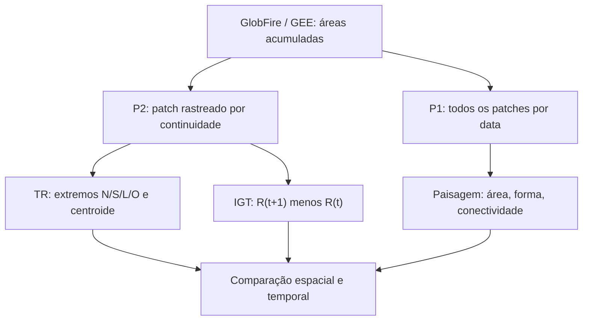

# Comparação preliminar TR × IGT — Pantanal (ID 24340828)

## Terminologia e estrutura

Os apelidos “método da Major” e “método do Coronel” foram abandonados **como
nomes de métodos**. A autoria acadêmica permanece nas citações. As duas
análises descrevem aspectos complementares da região P2, **não** precisam
produzir o mesmo azimute:

**TR** produz cinco trajetórias de posições geométricas representativas;
**IGT** produz o polígono de incremento, suas componentes e um resumo
direcional ponderado por área. O agrupamento de ambos não converte os
descritores em medições de velocidade ou de frente de fogo.

| Critério | TR | IGT |
| --- | --- | --- |
| Unidade | ponto representativo por data | área incremental por transição |
| Entrada | P2 acumulado, uma feição por data | mesmo P2 acumulado |
| Saída geométrica | 5 linhas por evento | polígonos `R_atual \ R_anterior` |
| Direção | azimute de mudança de posição de cada ponto | azimutes dos centroides das novas partes a partir do centroide anterior |
| Falha interpretativa típica | extremos podem trocar de identidade sem frente ativa mover | diferença pode revelar fusão, detecção tardia e ruído geométrico |

## Resultado auditado independentemente

Os valores **não** foram derivados das tabelas históricas da aplicação ao
furacão Beryl; foram recalculados dos P1/P2 versionados e validados:

| Item | Observado |
| --- | ---: |
| Datas P2 | 57 |
| Transições | 56 |
| Pontos e segmentos TR | 285 e 280 |
| Ranks P2 reproduzidos independentemente da seleção GEE | 57/57 |
| Soma de deslocamentos de centroides TR | 34,072 km |
| Área nova IGT acumulada nas transições | 949,843489 km² |
| Área anterior perdida IGT (total) | 0,000000526 km² |
| Polígonos componentes de IGT | 506 |
| Partes incrementais menores que 1 m² | 9 |
| Intervalos entre observações maiores que 1 dia | 3 |
| Maior erro de fechamento de área | 0,00000180 m² |

O número 506 descreve geometrias distintas no **resultado das diferenças**;
**não** é 506 focos de incêndio, nem fragmentação da paisagem original.
Nove partes são menores que 1 m² e devem ser tratadas como potenciais
artefatos antes de qualquer interpretação ecológica. Área perdida minúscula
indica oscilação numérica/topológica; preservar o valor evita ocultar
diferenças na aproximação do conjunto acumulado.

## Confronto científico ainda necessário

1. **Confirmar a referência do INPE:** o link encaminhado pelo orientador
   não abriu na consulta desta etapa. A diferença `R(t+1) \ R(t)` foi
   implementada a partir do **organograma** do projeto, e **não** afirmada
   como reconstrução validada das equações do artigo.
2. **Executar PostGIS:** conferir as três views de [`sql/`](../sql/) em
   uma base PostGIS 3+, após importar P2 com o esquema indicado no README;
   comparar em especial contagem de componentes (diferença planar WGS84 vs
   LAEA), azimutes e área total. A execução SQL ainda está pendente.
3. **Resolver métrica de direção:** confirmar se o interesse é centroide
   da área acrescida, média circular por componente, direção da maior
   componente, deslocamentos de extremos ou combinação dos indicadores.
4. **Resolução e escala:** a detecção deriva de MODIS MCD64A1 (aprox.
   500 m); variações centimétricas ou polígonos subpixel **não** implicam
   fronteiras físicas resolvidas pelo sensor.
5. **Generalização:** testar em um segundo ID com rank principal não
   constante, fusões e lacunas; o ID atual permaneceu rank 1 em todas as
   observações. Multi-ID nas views é suportado na lógica SQL, mas ainda
   requer esse ensaio empírico.

**Decisão metodológica sugerida:** apresentar TR e IGT como descritores
complementares, declarar explicitamente o caráter acumulado da variável e
tratar qualquer interpretação causal de expansão somente após cruzamento
com imagens, hidrografia, topografia e escala de detecção.
